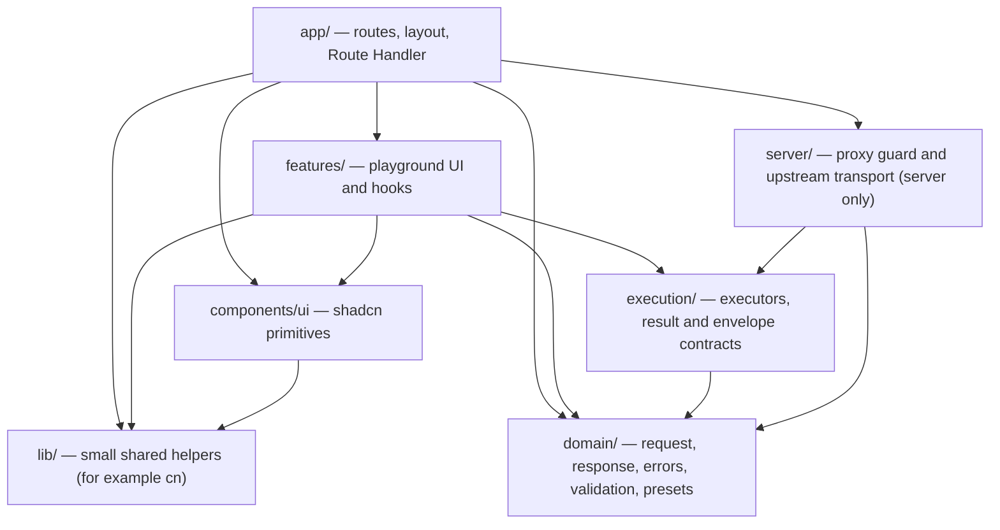

# Architecture

**Status:** Accepted · **Last reviewed:** 2026-11-24
**Depends on:** `SYSTEM_DESIGN.md` (logical design), `TECH_STACK.md`, `REQUIREMENTS.md`, `UI_UX_GUIDELINES.md`

## 1. Purpose

This document translates the logical design in `SYSTEM_DESIGN.md` into application structure: folders, module boundaries, dependency rules, runtime boundaries (server vs client), and the contracts between modules.

It does not repeat product requirements or the logical design. Decisions that need justification are recorded in `DECISIONS.md` and referenced here by ADR number.

## 2. Current Repository State

Verified against the repository on 2026-11-25. Re-verify before relying on it; `PROGRESS.md` is the living status.

| Item                 | State                                                                                                                                                                                                                                                                                                                                                                              |
| -------------------- | ---------------------------------------------------------------------------------------------------------------------------------------------------------------------------------------------------------------------------------------------------------------------------------------------------------------------------------------------------------------------------------- |
| `src/app/`           | Root `layout.tsx` (`<html>`, `<body>`, metadata, Geist font), placeholder `page.tsx`, `globals.css` with Tailwind and the shadcn theme                                                                                                                                                                                                                                             |
| Other `src/` folders | `lib/utils.ts` (`cn`), `test/setup.ts`; `domain/` with `errors/`, `request/`, `response/`; `execution/contract/` with `executor.ts`, `result.ts`, `envelope.ts`; `execution/browser-executor.ts`, `execution/limits.ts`; empty `server/`, `features/` (`.gitkeep`). `components/ui/` is created by the first `shadcn add`                                                          |
| `next.config.ts`     | `reactCompiler: true`, `cacheComponents: true`, `partialPrefetching: true`                                                                                                                                                                                                                                                                                                         |
| `tsconfig.json`      | `strict: true`. Path alias `@/*` maps to `./src/*`                                                                                                                                                                                                                                                                                                                                 |
| Runtime dependencies | `next` 16.4.6, `react` / `react-dom` 19.3.0, `react-hook-form` 7.92.0, `zod` 4.6.7, `@hookform/resolvers` 7.0.9; from `shadcn init`: `radix-ui`, `cn`, `class-variance-authority`, `lucide-react`, `tw-animate-css`, `shadcn`                                                                                                                                                      |
| Dev dependencies     | `tailwindcss` and `@tailwindcss/postcss` 4.3.3, `postcss` 8.5, `prettier` 3.10.1, `eslint-config-prettier` 10.1.8, `typescript` 5.9, `eslint` 9, `eslint-config-next` 16.4.6, `babel-plugin-react-compiler` 1.0.0, `vitest` 5.1.1, `@vitejs/plugin-react` 6.3.0, `jsdom` 31.0.1, `@testing-library/react` 16.3.3, `@testing-library/dom` 10.4.2, `@types/node` 22, `@types/react*` |
| Scripts              | `dev`, `build`, `start`, `lint`, `typecheck`, `format`, `format:check`, `test`, `test:watch`                                                                                                                                                                                                                                                                                       |
| Checks               | `lint` (including import-direction rules), `typecheck`, `format:check`, `test`, and `build` pass                                                                                                                                                                                                                                                                                   |

No known gaps against the M0 target.

## 3. Architectural Principles

Inherited from `SYSTEM_DESIGN.md` §10 and `TECH_STACK.md` §2, stated here as enforceable structure rules:

1. `src/app/` is for routing only. Application code lives in shared folders beside it under `src/`.
2. Domain code is plain TypeScript. It imports no React, no Next.js, and no browser or Node-specific globals beyond what Fetch provides in both runtimes.
3. Both execution strategies produce the same result type. UI code never knows which strategy ran, except to display it.
4. Server-only code never reaches the client bundle.
5. Components render state; they do not make execution or normalization decisions.

## 4. Layers and Dependency Direction



Rules:

- Arrows are the only permitted import directions.
- `domain/` and `lib/` import nothing from the other layers.
- `features/`, `components/`, and `execution/` never import from `server/`.
- `app/api/**/route.ts` stays thin: parse input, call into `server/` and `domain/`, return a response.
- Enforcement: ESLint `no-restricted-imports` rules per folder in `eslint.config.mjs`, plus `import "server-only"` in every `server/` entry module (ADR-013, ADR-021).

## 5. Folder Structure

Target structure. The top-level folders were created in M0; subfolders are added as they are first needed. Paths are relative to `src/`.

```
app/
  layout.tsx                # Server Component; html, body, theme class
  page.tsx                  # Server Component; renders the playground
  globals.css
  api/execute/route.ts      # Route Handler: proxy entry point (POST only)

components/ui/              # shadcn/ui primitives (generated by the shadcn CLI)

lib/                        # small helpers shared by UI code (utils.ts re-exports cn from the `cn` package)

features/
  playground/
    components/             # request editor, response inspector, tabs, layout
    hooks/                  # execution state, send and cancel handlers
    playground.tsx          # Client Component boundary
  theme/                    # theme toggle and preference cookie handling

domain/
  request/                  # request model, Zod schemas, URL building, validation
  response/                 # normalized response model, decoding, parsing, classification
  errors/                   # outcome categories and failure codes
  presets/                  # generic and public-API presets as data

execution/
  contract                  # executor interface, ExecutionResult, proxy envelope types
  browser-executor          # browser-direct strategy
  proxy-executor            # calls the Route Handler, maps the envelope
  limits                    # timeout and response size limit (OD-3)

server/
  proxy/                    # SSRF guard, upstream transport, timeout, size limit, header policy

test/                       # shared fixtures and test helpers
```

Exact file names are left to implementation. The boundaries above are what matter. Tests sit next to the code they cover (`TESTING_STRATEGY.md` §6).

## 6. Module Responsibilities

### 6.1 `domain/request`

Holds the single request model (URL, method, parameter rows, header rows, body, execution strategy) and its Zod schemas. The schemas are the shared source of truth: the form uses them through `@hookform/resolvers`, and the Route Handler re-validates incoming requests with the same schemas. Client-side validation is a convenience; server-side validation is the control (ADR-006). Also owns building the final URL from the base URL and enabled parameter rows (`API_INTEGRATION.md` §2.1).

### 6.2 `domain/response`

Holds the normalized response model and body handling:

- Raw body preserved as text when the content is textual.
- Parsed body derived separately, only when the content type and content allow it.
- Content-type classification (JSON, text, binary, empty) that drives the Body tab.
- Parse failures return the raw body plus a processing error. They never discard metadata.

### 6.3 `domain/errors`

Four outcome categories, kept as distinct types: validation, execution, response-processing, and HTTP error response (ADR-008). HTTP error responses are not errors at the type level: they are normal responses with an error status. Also holds the failure codes shared by both executors (`API_INTEGRATION.md` §5).

### 6.4 `execution/`

Defines one executor contract: given a validated request and an abort signal, return an `ExecutionResult`.

`ExecutionResult` is one of:

- **Response** (`kind: "response"`, `response`): a normalized response, including HTTP 4xx/5xx, optionally carrying a processing error.
- **Failure** (`kind: "failure"`, `failure`, `strategy`): an execution error (network, timeout, cancelled, response too large, proxy failure) with a failure code and no HTTP response. `strategy` records which executor ran, since there is no response to carry it.

An executor never rejects: every outcome resolves to an `ExecutionResult`. It receives the validated `RequestConfig`, so the proxy executor can send it for server-side re-validation.

Validation errors occur before an executor is called and never produce an `ExecutionResult`.

Both executors use the same normalization function, `normalizeResponse` in `domain/response`, so the response model is identical regardless of strategy. The executor is chosen by the user's explicit strategy choice. There is no fallback logic anywhere in this layer (ADR-005).

The proxy envelope types live in `execution/contract`, because both `server/` (producer) and `execution/proxy-executor` (consumer) depend on them and both may import `execution/`.

### 6.5 `server/proxy`

Contains all SSRF and resource controls from `API_INTEGRATION.md` §6. Isolated so it can be reviewed and tested on its own, and so it cannot be imported by client code. The upstream transport (the code that opens the connection) is passed in as a dependency so tests can replace it and DNS (`TESTING_STRATEGY.md` §4.3).

### 6.6 `features/playground`

UI only. Consumes domain types and the executor contract. Owns the execution state machine and layout (resizable split on desktop, stacked on smaller screens).

### 6.7 `features/theme`

The theme toggle and the code that reads and writes the theme preference cookie (ADR-018). It stores nothing else.

## 7. Server and Client Boundary

- `app/page.tsx` and `layout.tsx` are Server Components.
- The playground is a Client Component, because nearly everything in it is interactive (forms, tabs, resizable panels, execution state). Keep the `"use client"` boundary at the playground root. Static page chrome stays on the server.
- The Route Handler is the only server execution path. It exports `POST` only, since the request configuration travels in the body.
- The Route Handler runs on the Node.js runtime (the default). The proxy needs `node:dns` and control over the connection, which the Edge runtime does not provide.
- `server/` modules start with `import "server-only"`, so an accidental client import fails at build time (ADR-013).
- Caching: Route Handlers are not cached by default, and non-`GET` handlers are never cached (Next.js Route Handlers docs, 16.4). With Cache Components enabled (ADR-016), `GET` handlers follow the page model; RestLab exposes no `GET` handler. The upstream request still opts out of caching explicitly (`API_INTEGRATION.md` §2.5).

## 8. Execution Flows

### 8.1 Browser-direct

1. Form values are validated against the request schema.
2. The browser executor builds a Fetch call (final URL, headers, body, abort signal, `cache: "no-store"`).
3. The body is read once as bytes with a size limit, timing is captured, and the result is normalized.
4. Network-level failures, timeouts, and cancellation become Failure results. Any received response, regardless of status, becomes a Response result.

**Known limits.** CORS blocks many APIs, and browsers expose only CORS-safelisted response headers unless the server lists more in `Access-Control-Expose-Headers`. `Set-Cookie` is never visible. The UI shows these limits as a note, not as missing data.

### 8.2 Backend proxy

1. The browser posts the validated request to the Route Handler.
2. The handler checks the request origin and content type, re-validates with the shared schema, then runs the proxy guard.
3. The server performs the upstream request to the validated address, with a timeout, a size limit, and manual redirect handling.
4. The server normalizes the response with the shared function and returns it inside a proxy envelope.

**Envelope rule.** The transport status of the proxy call and the upstream HTTP status are different things. An upstream 404 arrives as a successful proxy call carrying a normalized response with status 404. Proxy-level problems use a separate failure shape. The proxy executor maps both into the same `ExecutionResult` (ADR-009, `API_INTEGRATION.md` §6.2).

## 9. State Management

- **Request configuration:** React Hook Form, validated by Zod. Parameter and header rows use field arrays.
- **Execution state:** a small state machine owned by one hook: idle, executing, completed (holding an `ExecutionResult`) (ADR-010).
- **Duplicate-submission control:** Send is disabled while executing. Each execution holds its own `AbortController`; Cancel aborts it, and unmounting aborts it. A result from an aborted execution never updates state.
- **Theme:** read from the preference cookie; the toggle writes it (ADR-018).
- **Context:** only if the request editor and response inspector genuinely need shared state that props cannot reasonably carry. Do not introduce it up front.
- **Persistence:** none for request data in the MVP.

## 10. Response Rendering

- Render response content as text. Never use `dangerouslySetInnerHTML` with response content, including HTML responses.
- JSON highlighting is an in-house tokenizer that emits React text nodes inside styled spans (ADR-015). No highlighting library and no lazy loading.
- Large bodies: above the display threshold, skip formatting and highlighting and show plain text (threshold is open item OD-6 in `DECISIONS.md`).
- Rendering code reads the normalized response and does no parsing of its own.

## 11. Error Handling Architecture

| Category            | Origin                                | Result shape                   | Body/metadata kept         |
| ------------------- | ------------------------------------- | ------------------------------ | -------------------------- |
| Validation          | Before execution                      | No `ExecutionResult`           | n/a                        |
| Execution           | Network, timeout, cancel, size, proxy | Failure with a failure code    | None available             |
| HTTP error          | Upstream status 4xx/5xx               | Response                       | Yes                        |
| Response-processing | After receipt                         | Response plus processing error | Raw body and metadata kept |

Error messages shown to users must not expose internal details (stack traces, internal hostnames, resolved IPs from blocked destinations).

## 12. Testing Boundaries

Detailed in `TESTING_STRATEGY.md` §4. The structure supports it directly:

- `domain/` and `execution/contract`: pure unit tests (Vitest, Node environment), no React.
- `server/proxy`: unit tests with a fake DNS resolver and a fake upstream transport; security cases written before the handler is exposed.
- Executors: unit tests with a mocked `fetch`.
- `features/`: React Testing Library in jsdom (ADR-019).
- Playwright: deferred.

## 13. Open Decisions

Tracked in one place: `DECISIONS.md` §5.

## 14. Maintenance

Update this document when module boundaries or dependency rules change. Record the reason in `DECISIONS.md`. Update §2 when the repository state changes in a way that affects the structure, and remove the "Known gaps" list once M0 is done.
