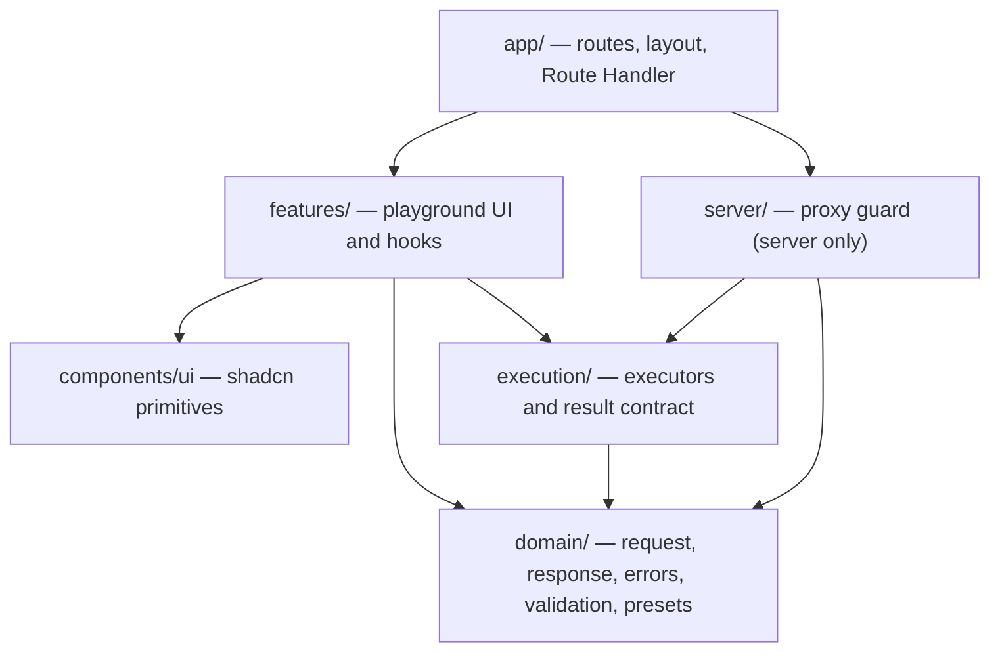

# Architecture

**Status:** Draft v0.3 — 20 November 2026
**Depends on:** `SYSTEM_DESIGN.md` (logical design), `TECH_STACK.md`, `REQUIREMENTS.md`, `UI_UX_GUIDELINES.md`

## 1. Purpose

This document translates the logical design in `SYSTEM_DESIGN.md` into application structure: folders, module boundaries, dependency rules, runtime boundaries (server vs client), and the contracts between modules.

It does not repeat product requirements or the logical design. Individual decisions that need justification are recorded in `DECISIONS.md` and referenced here as `ADR-?` until written.

## 2. Current Repository State

Verified from the files and directory listing supplied by the project owner on 20 Nov 2026. Re-verify before implementation.

| Item                      | State                                                                                                                                                 |
| ------------------------- | ----------------------------------------------------------------------------------------------------------------------------------------------------- |
| `src/app/`                | `layout.tsx`, `page.tsx`, `globals.css` only                                                                                                          |
| `docs/` (repository root) | `PROJECT_OVERVIEW`, `REQUIREMENTS`, `SYSTEM_DESIGN`, `TECH_STACK`, `UI_UX_GUIDELINES`                                                                 |
| `AGENTS.md`               | Empty                                                                                                                                                 |
| `README.md`               | Empty (as of previous inspection)                                                                                                                     |
| Runtime dependencies      | `next` 16.4.6, `react` / `react-dom` 19.3.0                                                                                                           |
| Dev dependencies          | `tailwindcss` 4.3.3, `@tailwindcss/turbopack` 4.3.3, `typescript`, `eslint`, `eslint-config-next`, `babel-plugin-react-compiler` 1.0.0, type packages |
| Scripts                   | `dev`, `build`, `start`, `lint`                                                                                                                       |

### Gaps against `TECH_STACK.md`

Not yet installed or configured: React Hook Form, Zod, `@hookform/resolvers`, shadcn/ui, Vitest, React Testing Library, Prettier. No `test`, `typecheck`, or `format` scripts exist.

### Decisions taken in this revision

- **`src/` directory.** All application code lives under `src/`. Folder paths in this document are relative to `src/` unless stated otherwise (ADR-001).
- **Tailwind integration.** Follow the official Next.js and Tailwind installation guides, which use `@tailwindcss/postcss` with a `postcss.config.mjs`. Replace the installed `@tailwindcss/turbopack` accordingly (ADR-003).
- **React Compiler.** Enabled (ADR-004). Do not add manual `useMemo` / `useCallback` / `memo` unless profiling shows a need.
- **Execution state.** Modeled as a small state machine with an `AbortController` per execution (§9, ADR-010).

- **Docs location.** Documentation lives in `docs/` at the repository root, matching the documentation strategy (ADR-002).

## 3. Architectural Principles

Inherited from `SYSTEM_DESIGN.md` §10 and `TECH_STACK.md` §2, stated here as enforceable structure rules:

1. `src/app/` is for routing only. Application code lives in shared folders beside it under `src/` (one of the strategies Next.js documents; Next.js itself is unopinionated here).
2. Domain code is plain TypeScript. It imports no React, no Next.js, and no browser or Node-specific globals beyond what Fetch provides in both runtimes.
3. Both execution strategies produce the same result type. UI code never knows which strategy ran, except to display it.
4. Server-only code never reaches the client bundle.
5. Components render state; they do not make execution or normalization decisions.

## 4. Layers and Dependency Direction



Rules:

- Arrows are the only permitted import directions.
- `domain/` imports nothing from the other layers.
- `features/` never imports from `server/`.
- `app/api/**/route.ts` stays thin: parse input, call into `server/` and `domain/`, return a response.

## 5. Proposed Folder Structure

This is a proposal, not the current state. Only `src/app/` exists today under `src/`. Paths are relative to `src/`, except `docs/`, which is at the repository root.

```
app/
  layout.tsx
  page.tsx                  # Server Component; renders the playground
  globals.css
  api/execute/route.ts      # Route Handler: proxy entry point

components/ui/              # shadcn/ui primitives (generated)

features/playground/
  components/               # request editor, response inspector, tabs, layout
  hooks/                    # execution state, send handler
  playground.tsx            # Client Component boundary

domain/
  request/                  # request model, Zod schemas, validation
  response/                 # normalized response model, parsing, content-type handling
  errors/                   # error categories and shapes
  presets/                  # generic and public-API presets as data

execution/
  contract                  # executor interface and ExecutionResult
  browser-executor          # browser-direct strategy
  proxy-executor            # calls the Route Handler, maps the envelope
  normalize                 # shared Response -> normalized response

server/
  proxy/                    # SSRF guard, timeout, size limit, header policy

```

Exact file names are left to implementation. The boundaries above are what matter.

## 6. Module Responsibilities

### 6.1 `domain/request`

Holds the single request model (URL, method, params, headers, body, execution strategy) and its Zod schemas. The schemas are the shared source of truth: the form uses them through `@hookform/resolvers`, and the Route Handler re-validates incoming requests with the same schemas. Client-side validation is a convenience; server-side validation is the control.

### 6.2 `domain/response`

Holds the normalized response model and body handling:

- Raw body preserved as text.
- Parsed body derived separately, only when the content type and content allow it.
- Content-type classification (JSON, text, other) that drives the Body tab.
- Parse failures return the raw body plus a processing error. They never discard metadata.

### 6.3 `domain/errors`

Four categories, kept as distinct types: validation, execution, response-processing, and HTTP error response. HTTP error responses are not errors at the type level: they are normal responses with an error status.

### 6.4 `execution/`

Defines one executor contract: given a validated request, return an `ExecutionResult`.

`ExecutionResult` is one of:

- **Response:** a normalized response, including HTTP 4xx/5xx, optionally carrying a processing error.
- **Failure:** an execution error (network, timeout, proxy failure) with no HTTP response.

Validation errors occur before an executor is called and never produce an `ExecutionResult`.

Both executors use the same normalization function, so the response model is identical regardless of strategy. The selected executor is chosen by the user's explicit strategy choice. There is no fallback logic anywhere in this layer.

### 6.5 `server/proxy`

Contains all SSRF and resource controls from `SYSTEM_DESIGN.md` §5.3. Isolated so it can be reviewed and tested on its own, and so it cannot be imported by client code.

### 6.6 `features/playground`

UI only. Consumes domain types and the executor contract. Owns the execution state machine and layout (resizable split on desktop, stacked on smaller screens).

## 7. Server and Client Boundary

- `app/page.tsx` and `layout.tsx` are Server Components.
- The playground is a Client Component, because nearly everything in it is interactive (forms, tabs, resizable panels, execution state). Keep the `"use client"` boundary at the playground root. Static page chrome stays on the server.
- The Route Handler is the only server execution path. Use `POST`, since the request configuration travels in the body.
- Mark `server/` modules as server-only so an accidental client import fails at build time (mechanism: `ADR-?`).
- Verify Route Handler caching behavior for the installed Next.js version at implementation time (`TECH_STACK.md` §4 requires explicit caching control). Set it explicitly on the server-side upstream fetch regardless of defaults.

## 8. Execution Flows

### 8.1 Browser-direct

1. Form values are validated against the request schema.
2. The browser executor builds a Fetch call (headers, body, abort signal).
3. The body is read once as text, timing is captured, and the result is normalized.
4. Network-level failures become Failure results. Any received response, regardless of status, becomes a Response result.

**Known limits.** CORS blocks many APIs, and browsers expose only CORS-safelisted response headers unless the server exposes more. Response size and some headers may not be measurable. The UI should show these as "not available", not as zero or empty.

### 8.2 Backend proxy

1. The browser posts the validated request to the Route Handler.
2. The handler re-validates with the shared schema, then runs the proxy guard.
3. The server performs the upstream Fetch with a timeout and a size limit.
4. The server normalizes the response with the shared function and returns it inside a proxy envelope.

**Envelope rule.** The transport status of the proxy call and the upstream HTTP status are different things. An upstream 404 must arrive as a successful proxy call carrying a normalized response with status 404. Proxy-level problems (invalid request, blocked destination, timeout, upstream unreachable) use a separate failure shape. The proxy executor maps both into the same `ExecutionResult`. The envelope is proposed in ADR-009; the exact contract is still open.

## 9. State Management

- **Request configuration:** React Hook Form, validated by Zod.
- **Execution state:** a small state machine owned by one hook: idle, executing, completed (holding an `ExecutionResult`).
- **Duplicate-submission control:** disable Send while executing, and hold an `AbortController` per execution so a superseded or cancelled request cannot overwrite newer state.
- **Context:** only if the request editor and response inspector genuinely need shared state that props cannot reasonably carry. Do not introduce it up front.
- **Persistence:** none in the MVP.

## 10. Response Rendering

- Render response content as text. Never use `dangerouslySetInnerHTML` with response content, including HTML responses.
- The syntax-highlighting library is not yet chosen (`TECH_STACK.md` §6). Whichever is selected should be loaded lazily, since it is needed only after a response arrives.
- Large bodies: avoid highlighting or formatting very large payloads synchronously. Define a size threshold and a plain-text fallback during implementation.
- Rendering code reads the normalized response and does no parsing of its own.

## 11. Error Handling Architecture

| Category            | Origin                  | Result shape                   | Body/metadata kept         |
| ------------------- | ----------------------- | ------------------------------ | -------------------------- |
| Validation          | Before execution        | No `ExecutionResult`           | n/a                        |
| Execution           | Network, timeout, proxy | Failure                        | None available             |
| HTTP error          | Upstream status 4xx/5xx | Response                       | Yes                        |
| Response-processing | After receipt           | Response plus processing error | Raw body and metadata kept |

Error messages shown to users must not expose internal details (stack traces, internal hostnames, resolved IPs from blocked destinations).

## 12. Testing Boundaries

Matches `TECH_STACK.md` §7. Structure supports this directly:

- `domain/` and `execution/normalize`: pure unit tests (Vitest), no React.
- `server/proxy`: unit tests for destination rules, with security cases written before the handler is exposed.
- Executors: unit tests with a mocked Fetch.
- `features/playground`: React Testing Library for states (initial, loading, success, HTTP error, failure, processing error).
- Playwright: deferred.

## 13. Open Decisions

| #   | Decision                          | Notes                                    |
| --- | --------------------------------- | ---------------------------------------- |
| 1   | Server-only enforcement mechanism | Build-time failure vs convention         |
| 2   | Proxy envelope contract           | Success and failure shapes               |
| 3   | Proxy limits                      | Timeout, max body size, redirect policy  |
| 4   | Size measurement                  | Browser vs server, headers vs bytes read |
| 5   | Syntax highlighter                | Bundle size, performance, maintenance    |
| 6   | Large-response threshold          | Highlighting and display fallback        |
| 7   | Binary response handling          | Display and size behavior                |

## 14. Maintenance

Update this document when module boundaries or dependency rules change. Record the reason in `DECISIONS.md`. When the folder structure is created, replace §5's "proposal" wording with the actual structure.
