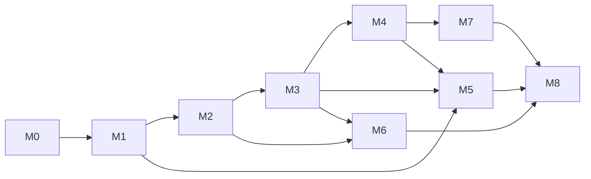

# Project Plan

**Status:** Accepted · **Last reviewed:** 2026-11-27
**Depends on:** `ROADMAP.md`, `ARCHITECTURE.md`, `TESTING_STRATEGY.md`, `DECISIONS.md`

## 1. Purpose

This plan breaks the MVP into milestones. Each milestone has a goal, deliverables, acceptance criteria, and the open decisions it must close. Dates are intentionally omitted. Status is tracked in `PROGRESS.md`.

## 2. Working Method

- Every task follows the workflow in `AGENTS.md`: understand, plan, get approval, execute, verify, explain.
- A milestone may span several tasks. Each task ends with a working, checked state.
- Official documentation is checked before version-sensitive work. For Next.js, the version-matched docs in `node_modules/next/dist/docs/` come first.
- Each new dependency is proposed with a reason and approved before it is installed.
- Changes are left uncommitted. The project owner reviews and commits them. A suggested commit message and file list are provided at the end of each task, one logical change per commit.
- A milestone is done only when its acceptance criteria and the Definition of Done in `TESTING_STRATEGY.md` §8 are met. At that point `PROGRESS.md` and `CHANGELOG.md` are updated.

## 3. Milestones

### M0: Foundation

**Goal.** A repository ready for feature work.

Suggested as four separate tasks and commits:

1. **App shell and config.** Fix the root layout (`<html>`, `<body>`, render `children`, import `globals.css`). Point the `@/*` alias at `./src/*` (ADR-001). Replace `@tailwindcss/turbopack` with `@tailwindcss/postcss` and `postcss.config.mjs`, and remove the Turbopack CSS rule (ADR-003).
2. **Formatting and scripts.** Install and configure Prettier. Add `typecheck`, `format`, and `format:check` scripts. Format existing files in a separate, formatting-only commit.
3. **Testing.** Install Vitest, `@vitejs/plugin-react`, jsdom, and React Testing Library (ADR-019; `vite-tsconfig-paths` replaced by Vite's native `resolve.tsconfigPaths`). Add `test` and `test:watch`. One trivial passing test proves the setup.
4. **Forms, UI kit, structure.** Install React Hook Form, Zod, and `@hookform/resolvers`. Run `shadcn init` (review the packages it adds). Create the folder skeleton (`ARCHITECTURE.md` §5). Add ESLint import-direction rules (ADR-021). Write `README.md` (purpose, requirements, setup, scripts).

Optional: decide OD-10 and add a CI workflow that runs lint, typecheck, format check, tests, and build.

**Acceptance.** `dev`, `build`, `lint`, `typecheck`, `format:check`, and `test` all run cleanly. A deliberate wrong-direction import fails `lint`.

### M1: Domain Core

**Goal.** The request and response domain, fully tested, with no UI.

**Deliverables**

- Request model and Zod schemas (ADR-006): parameter and header rows with enabled flags, body type and per-method rules (ADR-017), URL rules including credentials, final URL building.
- Normalized response model, decoding, content-type classification, parsing (ADR-007, ADR-014).
- Outcome categories and the shared failure codes (ADR-008, `API_INTEGRATION.md` §5).
- `ExecutionResult` and proxy envelope types in `execution/contract`. Closes OD-1.

**Acceptance.** Domain tests in `TESTING_STRATEGY.md` §4.1 pass. No React or Next.js imports in `domain/`.

### M2: Browser Execution and State

**Goal.** Send a request from code and get a normalized result.

**Deliverables**

- Browser executor: combined cancel and timeout signal, `cache: "no-store"`, byte-counting read with size limit, decoding, timing.
- Shared normalization applied to Fetch responses.
- Execution state machine hook with Cancel and unmount abort (ADR-010).
- Confirm the timeout and size values (OD-3, first half).

**Acceptance.** Execution tests in §4.2 pass for the browser executor. HTTP errors are returned as responses, and network failures, timeouts, and cancellations as failures with the right codes.

### M3: Request Editor

**Goal.** Users can configure and send a request (browser-direct only, ADR-020).

**Deliverables**

- URL input with final URL preview, method selector, Send/Cancel button.
- Params, Headers, and Body tabs with row add, edit, remove, enable, and disable. Body type selector; body disabled for GET.
- Validation feedback, including the forbidden-header warning.
- A basic stacked page layout and the result wired to a minimal output, replaced in M4.

**Acceptance.** Editor component tests pass. Fully keyboard operable with labeled controls.

### M4: Response Inspector

**Goal.** Users can inspect any outcome.

**Deliverables**

- Overview, Body, and Metadata tabs as defined in `UI_UX_GUIDELINES.md` §4.
- In-house JSON highlighter (ADR-015), plain-text and fallback rendering, inline copy feedback.
- Distinct displays for initial, loading, success, HTTP error, execution failure, cancelled, and processing error.
- Close OD-6 (display threshold) and OD-7 (binary display).

**Acceptance.** Inspector component tests pass. Empty, malformed, binary, and large responses display usefully. Response content is never injected as HTML.

### M5: Saved Templates and Guide

**Goal.** Let users save and re-send their own requests, and help first-time users get started (ADR-026 to ADR-028).

**Deliverables**

1. Scope change recorded: FR-03 rewritten, FR-09 added, ADR-026 to ADR-028, OD-12 opened.
2. Template model (`domain/templates`), IndexedDB store, and Web Crypto encryption (`features/templates`), with tests using `fake-indexeddb`.
3. Templates UI: a saved-templates panel, Save and Save as new, the encryption choice with the plain-text warning, unlock and lock, rename, delete with confirmation, and a "Modified" marker.
4. Guide pages, the public API directory with "Try it" links, a header navigation, and a guide link in the empty response area. Close OD-12 first. Each directory entry is checked against its current documentation.

**Acceptance.** Templates survive a reload, and encrypted ones need their passphrase again after it. Damaged records and missing storage show a message instead of breaking the page. Every directory sample passes the request schema. Manual run of each "Try it" sample against its real API.

### M6: Backend Proxy

**Goal.** Safe proxy execution and strategy selection.

**Deliverables**

1. Spike: choose how to connect to the validated address (OD-2) and record the ADR.
2. Destination policy, redirect handling, timeout, size limits, and incoming checks, with the test matrix in `TESTING_STRATEGY.md` §4.3 written first. Close OD-3 (second half), OD-4, and OD-5.
3. `POST /api/execute` Route Handler and proxy executor.
4. Strategy selector in the editor (default browser-direct), CORS hint, and blocked-destination explanation.

**Acceptance.** The full §4.3 matrix passes before the endpoint is reachable beyond local development. Upstream errors arrive as responses, never as proxy failures. The strategy never changes on its own.

### M7: Responsive Layout, Theme, and Accessibility

**Goal.** A polished, usable interface across screen sizes and themes.

**Deliverables**

- Resizable split layout on desktop; stacked layout on tablet and mobile.
- Light and dark themes with a toggle and preference cookie (ADR-018). Close OD-8 first.
- Focus indicators, contrast in both themes, and accessible loading and error announcements.
- No horizontal overflow with wide JSON and headers.

**Acceptance.** Manual checks in `TESTING_STRATEGY.md` §7 pass. Theme choice survives a reload with no flash.

### M8: MVP Hardening

**Goal.** Meet the acceptance criteria in `REQUIREMENTS.md` §8.

**Deliverables**

- Walkthrough of every acceptance criterion and manual check.
- Review of error messages for leaked detail, and a security review of the proxy and of template storage and encryption.
- Decide the deployment target and rate limiting (OD-9) before any public deployment. Decide OD-11.
- Documentation brought in line with the implementation.

**Acceptance.** Every criterion in `REQUIREMENTS.md` §8 is met and demonstrable.

## 4. Dependencies Between Milestones

M0 comes before everything. M5 and M6 can run in either order. M6 needs M3; M5 also needs M4, for the guide link in the empty response area. M7 follows M4 and should include the strategy selector if M6 is done by then.

## 5. Risks

| Risk                                             | Mitigation                                                                                                |
| ------------------------------------------------ | --------------------------------------------------------------------------------------------------------- |
| SSRF protection incomplete or bypassable         | Test matrix first, proxy kept private until M6 acceptance, security review in M8 before public exposure   |
| DNS rebinding cannot be closed with native Fetch | Spike at the start of M6; `node:https` with a custom `lookup` is a no-dependency fallback                 |
| CORS limits browser-direct usefulness            | Clear UI hints; user-chosen proxy strategy; documented limits                                             |
| Public example APIs change or go down            | Directory samples are starting points with a "last checked" date; manual check; no live APIs in tests     |
| Secrets saved in browser storage                 | Per-template passphrase encryption (ADR-027), a plain-text warning, never sent to the server, M8 review   |
| Large responses freeze the UI                    | Size limit while reading (M2); display threshold and plain-text fallback (M4)                             |
| Theme flash or Cache Components friction         | OD-8 decided at the start of M7, checked against the bundled Next.js docs                                 |
| Version drift in Next.js, React, or Tailwind     | Check official documentation before version-sensitive work; record upgrades in `CHANGELOG.md`             |
| Scope creep in a first production-level project  | Follow the roadmap; record scope changes in `REQUIREMENTS.md` and `DECISIONS.md` before implementing them |

## 6. Out of Plan

Post-MVP items in `ROADMAP.md` §5 and §6 are not scheduled here.
