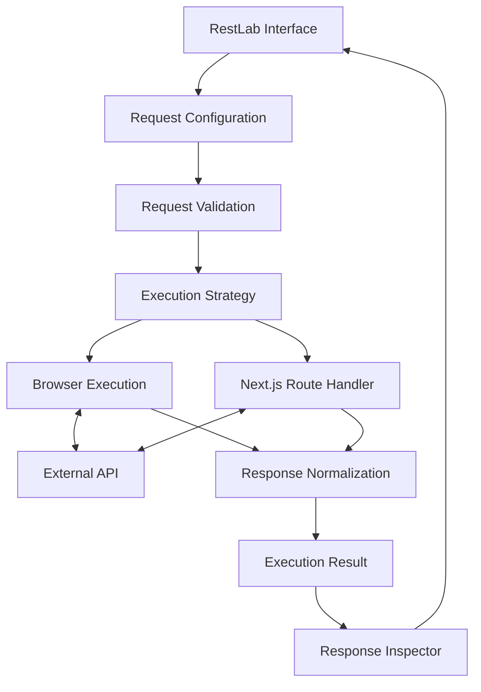
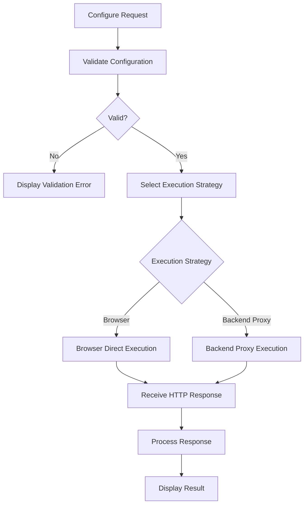
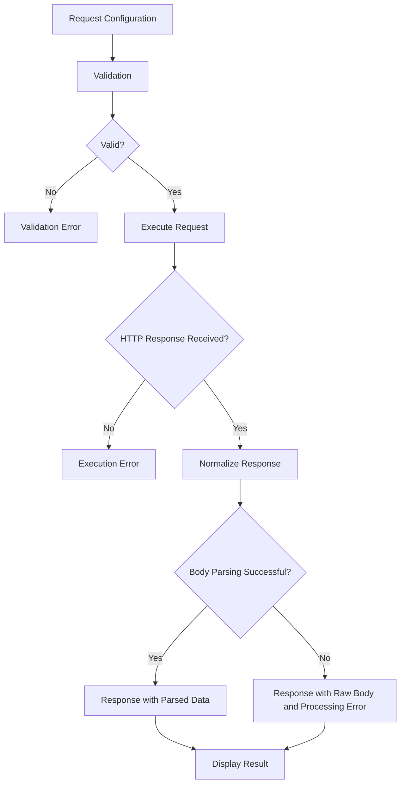

# System Design

**Status:** Accepted · **Last reviewed:** 2026-11-24

## 1. Purpose

This document describes RestLab's logical architecture, primary data flows, request execution model, response representation, and error-handling strategy.

It defines system-level responsibilities without prescribing the final folder structure or implementation details. Those belong in `ARCHITECTURE.md`.

## 2. High-Level Architecture

RestLab follows a layered design:

1. **Presentation layer** — request configuration, execution controls, and response inspection UI.
2. **Request domain layer** — request representation, validation, and execution coordination.
3. **Execution layer** — browser-direct execution or Next.js backend proxy execution.
4. **Response processing layer** — response normalization, body preservation, and parsing.
5. **External services** — APIs called by the user.

This is a logical architecture. It does not prescribe specific modules or components.

## 3. Request Model

RestLab will use a unified logical request model.

The request configuration is one domain-level representation, while the UI manages its sections independently.

The model must represent:

- Request URL.
- HTTP method.
- Query parameters.
- Request headers.
- Request body.
- Execution strategy.
- Relevant request configuration needed for execution.

The model should support presets, validation, and both execution strategies without coupling the domain representation to individual UI components.

### API source and execution strategy

These are independent concepts:

**API source**

- Predefined API example.
- User-provided URL.

**Execution strategy**

- Browser-direct.
- Backend proxy.

A predefined public API may still require proxy execution because of CORS restrictions. A user-provided URL may also be publicly accessible or privately hosted.

Therefore, API source must not determine execution strategy.

Users select the execution strategy. Browser-direct is the default (ADR-020). RestLab may provide guidance, but must not silently switch strategies when execution fails.

## 4. Request Lifecycle

The lifecycle should:

- Validate request configuration before execution.
- Provide clear loading feedback.
- Prevent accidental duplicate submissions while a request is executing.
- Allow the user to cancel an executing request, and stop waiting after a timeout.
- Preserve the distinction between HTTP responses and transport failures.
- Return a consistent execution result to the presentation layer.

## 5. Execution Strategies

### 5.1 Browser-direct execution

The browser sends the request directly to the target API.

**Advantages**

- Simpler request path.
- No application server proxy required.
- Avoids additional server infrastructure for execution.

**Limitations**

- Subject to browser CORS restrictions.
- Some APIs may reject browser-originated requests.
- Browser security restrictions limit access to certain response details.

### 5.2 Backend proxy execution

A Next.js backend endpoint receives the request configuration, sends the request to the target API, and returns a normalized result.

**Advantages**

- Can support APIs that do not allow browser cross-origin requests.
- Provides a controlled server-side execution boundary.
- Allows centralized request and response handling.

**Limitations**

- Adds server-side complexity and latency.
- Requires resource and destination safeguards.
- Introduces security concerns when users can specify arbitrary URLs.

### 5.3 Proxy security considerations

Accepting arbitrary destination URLs creates Server-Side Request Forgery (SSRF) risks.

The backend proxy design must account for:

- Blocking loopback, private, link-local, and other restricted IP ranges.
- Blocking cloud metadata endpoints.
- Validating destination URLs and resolved IP addresses.
- Rechecking destinations after DNS resolution and redirects.
- Applying request timeouts and response-size limits.
- Restricting supported protocols.
- Avoiding unintended forwarding of sensitive headers or credentials.
- Preventing the proxy from becoming an unrestricted network relay.

The controls are specified in `API_INTEGRATION.md` §6.

Browser-direct execution also requires safe handling of user-provided URLs and response content.

## 6. Response Representation

RestLab will preserve the raw response content and derive parsed data separately.

It must not treat the native browser Fetch `Response` object as the application's complete response representation. That object contains runtime-specific behavior and a consumable body stream; it is not a suitable normalized, serializable domain object.

Instead, RestLab will use a normalized response representation containing relevant information such as:

- HTTP status code.
- Status text.
- Response headers.
- Response duration.
- Response size, measured as the decoded body bytes read (ADR-014).
- Content type.
- Raw response body.
- Parsed response body, when parsing succeeds.

The exact fields are defined in `API_INTEGRATION.md` §4.2.

The response body should be consumed only once. Parsing and display operations should work from the preserved body content.

The normalized representation should remain consistent across browser-direct and backend-proxy execution.

## 7. Response Inspector

The response inspector will provide three tabs.

### 7.1 Overview

Displays the complete normalized response in one place: a short summary line (outcome, status, duration, size) followed by the whole normalized response as read-only, formatted JSON, including headers and body.

This is an application-level representation, not the native Fetch `Response` object. It answers "what exactly came back?"; the Body and Metadata tabs are focused views of parts of it.

### 7.2 Body

Displays the response content.

Expected behavior:

- Format and syntax-highlight JSON.
- Display plain text when appropriate.
- Handle HTML and other text content without assuming JSON.
- Provide a fallback for unsupported content types.
- Support copying response content.

### 7.3 Metadata

Displays response information, including:

- Status code and status text.
- Response headers.
- Duration.
- Response size.
- Content type.
- Execution strategy used.
- Execution outcome.

Execution outcome is logically separate from HTTP metadata, even though the UI presents it in this tab.

The inspector must remain useful when a response has an empty body or its content cannot be parsed.

## 8. Error Handling

Outcomes are separated into four categories (ADR-008): request validation errors, execution errors, response-processing errors, and HTTP error responses. Only the first three are errors; an HTTP error response is a valid response.

### 8.1 Request validation errors

Occur before execution.

Examples:

- Missing or invalid URL.
- Invalid request configuration.
- Invalid header or parameter configuration.
- Unsupported request configuration.

These errors should be displayed without initiating a network request.

### 8.2 Execution errors

Occur while attempting to execute a request.

Examples:

- Network failures.
- Connection failures.
- Timeouts.
- Cancellation by the user.
- Proxy execution failures.

These errors should be distinguishable from HTTP error responses.

### 8.3 Response-processing errors

Occur after receiving a response.

Examples:

- JSON parsing failures.
- Unexpected response formats.
- Unsupported content types.

A parsing failure must not discard the original response content or available metadata.

### 8.4 HTTP error responses

HTTP error status codes, such as 404 or 500, are still valid HTTP responses.

RestLab should preserve and display their status, headers, and body when available. An HTTP error response must not be misclassified as a network failure.

### Error flow

## 9. State and Persistence

For the MVP:

- Request configuration exists temporarily in the active application session.
- No request history or saved requests.
- No persistent storage of request data. The theme preference cookie is the only stored value (ADR-018).
- No account or cloud synchronization.

The design should avoid making future persistence impossible, but should not introduce persistence infrastructure prematurely.

## 10. Design Principles

- Keep domain logic independent of presentation components.
- Use one logical request model across execution strategies.
- Normalize execution results so the UI does not depend on the underlying execution mechanism.
- Preserve raw response content before parsing.
- Distinguish validation, execution, HTTP, and response-processing outcomes.
- Treat user-provided URLs as untrusted input.
- Keep the architecture extensible without introducing unnecessary abstractions.
- Prefer explicit execution behavior over silent fallbacks.

## 11. Where Details Live

- Module and folder boundaries: `ARCHITECTURE.md`.
- Request construction, response fields, proxy contract, and SSRF controls: `API_INTEGRATION.md`.
- Settled decisions and the open-decisions register: `DECISIONS.md`.
